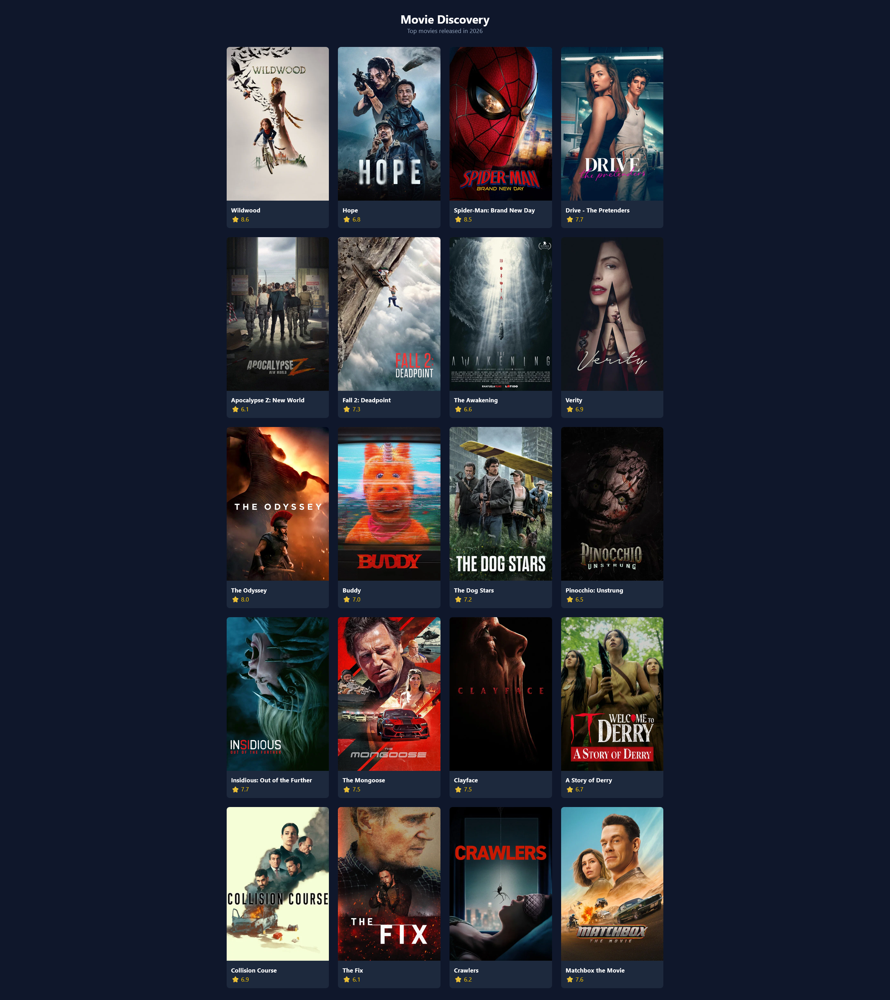

# TMDB Movie Discovery App

A responsive movie discovery web application built with React, TypeScript, TanStack Query, and Tailwind CSS. It fetches popular movie data from The Movie Database (TMDB) API, displays items in a responsive grid, and provides interactive card states.

<p align="center">
  
</p>

## Features

- **TMDB API Integration**: Fetches movie data from the `/discover/movie` endpoint.
- **Filtering & Sorting**: Filters movies by release year (`2026`) and sorts by popularity descending (`popularity.desc`).
- **Server State Management**: Handled via TanStack Query for caching and clean loading/error states.
- **Responsive Grid**: Built with Tailwind CSS, adapting smoothly across mobile, tablet, and desktop viewports.
- **Interactive UI**: Movie cards feature hover animations and uniform poster aspect ratios.

## Tech Stack

- **Framework**: React 19 + Vite
- **Language**: TypeScript
- **State Management**: TanStack Query (React Query)
- **Styling**: Tailwind CSS v4

## Getting Started

### Prerequisites

- Node.js (v18+ recommended)
- A TMDB API Key (v3)

### Quick Start

```bash
# Install dependencies and start the local dev server
npm i && npm start